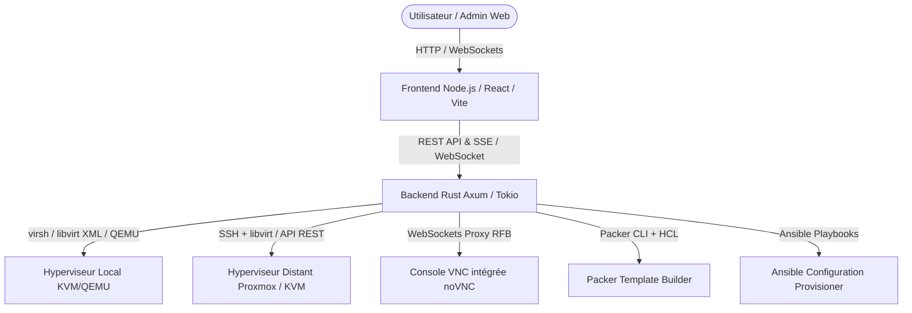

# VirtManager Pro (Proxmox-like Cloud Management Platform)

## 1. Contexte & Architecture
VirtManager Pro est une plateforme de virtualisation et de cloud privé conçue selon les spécifications du projet de 5ème année.
Elle offre une interface unique et moderne (inspirée de Proxmox VE) pour piloter l'ensemble du cycle de vie des machines virtuelles, gérer les hyperviseurs locaux et distants, et automatiser la création d'images via Packer et Ansible.

## 2. Modules Fonctionnels
- **Module A - Gestionnaire de VM**:
  - Cycle de vie : Création, Démarrage, Arrêt (ACPI / Forcé), Redémarrage, Suppression.
  - Attribution & Contrôle d'accès : Affectation d'une VM à un utilisateur standard avec gestion de quotas.
  - Clonage : Clonage instantané (Full clone ou Linked clone avec snapshot).
  - Console VNC : Accès graphique direct dans le navigateur sans plugin via proxy WebSocket (noVNC).
  - Gestion du stockage et disques : Création, redimensionnement (resize), suppression des volumes qcow2/raw, gestion des pools de stockage.

- **Module B - Gestionnaire d'Hyperviseurs**:
  - Enregistrement : Ajout dynamique d'hyperviseurs locaux (`qemu:///system`) ou distants (via SSH `qemu+ssh://...` ou API Proxmox VE).
  - Surveillance : Télémétrie en temps réel (CPU %, RAM utilisée/totale, Espace disque des pools, Nombre de VM actives).
  - Retrait sécurisé : Blocage du retrait si des VM sont en cours d'exécution.

- **Module C - Gestionnaire de Templates & Automatisation**:
  - Catalogue de templates prêts à l'emploi (Debian, Ubuntu, Alpine, Nginx server, Docker host).
  - Automatisation Packer : Fichiers `.pkr.hcl` configurés pour générer des images qcow2 standardisées.
  - Automatisation Ansible : Playbooks de durcissement et personnalisation (ex: installation Docker, Nginx, configuration SSH).
  - Déploiement 1-click depuis un template vers une VM active.

## 3. Sécurité & Authentification
- Authentification JWT avec rôles :
  - `admin` : Gestion totale de l'infrastructure, hyperviseurs, utilisateurs, templates.
  - `user` : Accès restreint uniquement aux VM qui lui sont attribuées, console VNC, démarrage/arrêt.
